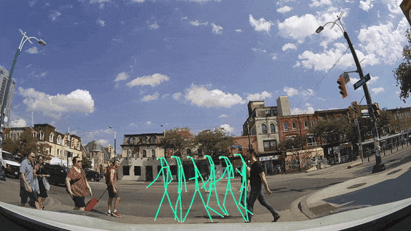
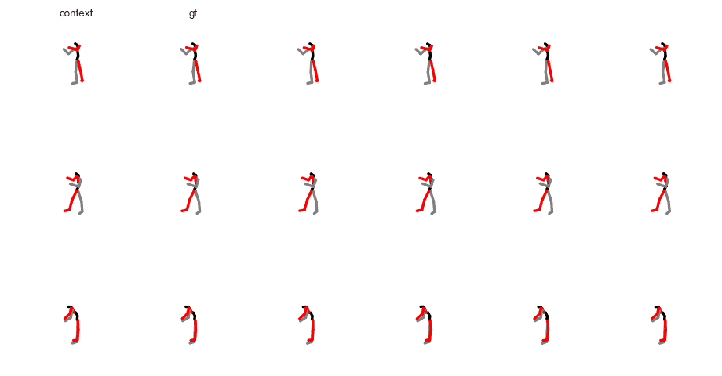
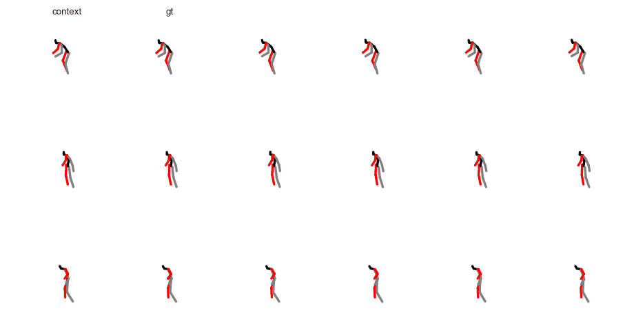
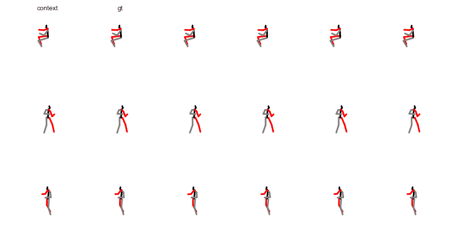
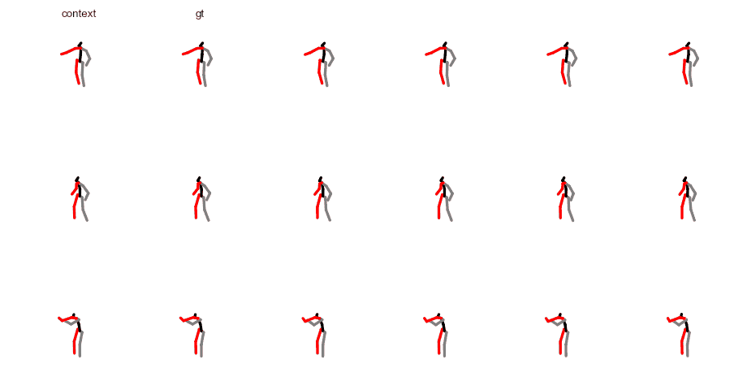
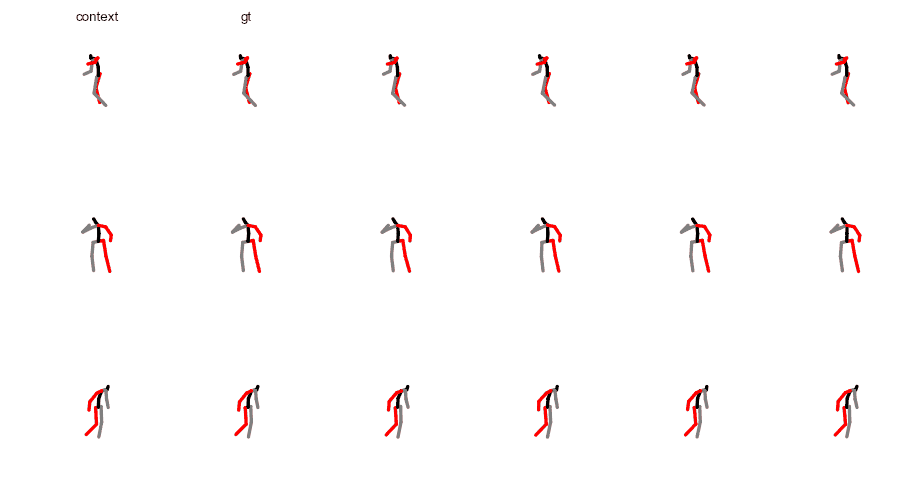
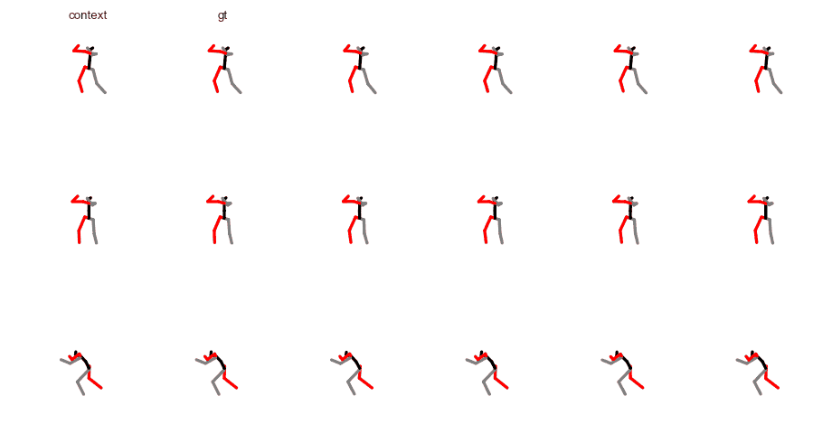
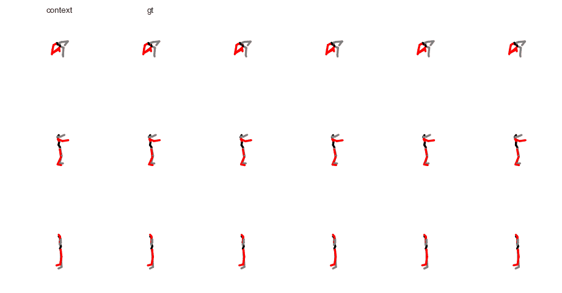
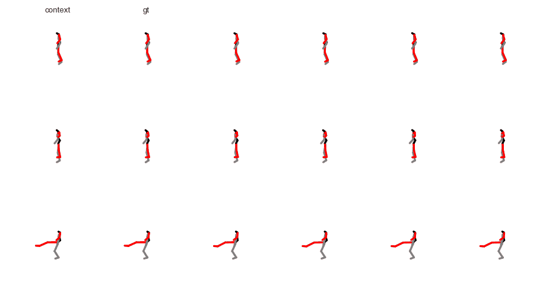

# Fast Diffusion Sampling for Stochastic Human Motion Prediction

Given a short history of 3D poses, predict a *set* of plausible future motions in a handful of network evaluations.

<p align="center">
  
  <br>
  <sub>Human pose forecasting in the wild. Illustration from the
  <a href="https://www.epfl.ch/labs/vita/research/prediction/human-pose-forecasting/">Human Pose Forecasting</a>
  page of the VITA lab, EPFL (Saadatnejad et al., 2024); not produced by this work.</sub>
</p>

This repository contains the code of an Honours thesis at the Australian National University. It combines a
Diffusion Transformer denoiser for human motion with fast ODE solvers (DPM-Solver and DPM-Solver++) and
masked completion of the observed frames, so that a full set of diverse, accurate predictions is drawn in as few as
**6 network evaluations per sample**. The thesis is available on request.

---

## Problem

Human motion is not deterministic. A person rising from a chair may walk to the door, turn towards a table or reach
for an object, and each continuation is consistent with what was observed. A useful predictor therefore models a
*distribution* over futures and samples from it (stochastic human motion prediction).

Diffusion models are now the strongest generative models for this task, but they are slow: each sample normally
needs one network evaluation per reverse diffusion step, often 100 or more, and a forecast consists of many samples.
For interactive or safety-critical applications (autonomous driving, human-robot handover, AR/VR) that latency
decides whether the method can be deployed at all.

## Approach

**Representation.** The observed history and the future are treated as one sequence and moved to the frequency
domain with the discrete cosine transform (DCT), keeping only the low-frequency coefficients. Prediction becomes
completion of a masked DCT sequence, following HumanMAC (Chen et al., 2023).

**Denoiser.** A Diffusion Transformer (Peebles & Xie, 2023) operating on DCT coefficients, with two interchangeable
conditioning blocks (adaLN-Zero, or the stylization block of MotionDiffuse), Squeeze-and-Excitation modules that
recalibrate individual frequency bands, and a graph convolutional refinement stage that encodes the skeleton.
The model is trained in a single stage with a single best-of-K noise-prediction loss.

**Sampler.** Sampling is cast as solving the probability flow ODE with DPM-Solver (Lu et al., 2022) or the
data-prediction variant DPM-Solver++ (Lu et al., 2025, called *Guided DPM-Solver* in this work). After every
solver step, the observed frames are re-injected at the current noise level (masking, in the spirit of
RePaint, Lugmayr et al., 2022), so every sample stays consistent with the history. Steps are spaced uniformly in
log-SNR.

<p align="center">
  
</p>

## Results

### Samples

Human3.6M (first two rows) and AMASS (last row) test sequences rendered with `--mode demo_vis --sampling_mode pred`. In each panel, the first column (*context*)
shows the observed motion, the second (*gt*) the recorded future, and the remaining columns four predicted futures for
the same observation; each row is a different observation. Observed frames are drawn in gray, black and red, predicted
frames in purple, black and green.

<table>
<tr>
<td align="center" width="33%"><br><sub>Directions</sub></td>
<td align="center" width="33%"><br><sub>Discussion</sub></td>
<td align="center" width="33%"><br><sub>Eating</sub></td>
</tr>
<tr>
<td align="center" width="33%"><br><sub>Greeting</sub></td>
<td align="center" width="33%"><br><sub>Phoning</sub></td>
<td align="center" width="33%"><br><sub>Photo</sub></td>
</tr>
<tr>
<td align="center" width="33%"><br><sub>AMASS: DanceDB</sub></td>
<td align="center" width="33%"><br><sub>AMASS: DFaust</sub></td>
<td align="center" width="33%"><br><sub>AMASS: GRAB</sub></td>
</tr>
</table>


Human3.6M, standard protocol (25 observed frames, 100 predicted frames, 50 samples per observation).
NFE counts network evaluations per sample; for this work NFE† counts solver evaluations, and one final denoising
evaluation brings the cost of a sample to NFE† + 1 (for example, 6 at NFE† = 5).

| Method | Stages | NFE | APD | ADE ↓ | FDE ↓ | MMADE ↓ | MMFDE ↓ | CMD ↓ | FID ↓ |
|---|---|---|---|---|---|---|---|---|---|
| HumanMAC | 1 | 100 | 6.301 | 0.369 | 0.480 | 0.509 | 0.545 | – | – |
| BeLFusion | ≥2 | 10 | 7.602 | 0.372 | 0.474 | **0.473** | 0.507 | 5.988 | 0.209 |
| CoMusion | 1 | 10 | 7.632 | **0.350** | 0.458 | 0.494 | **0.506** | 3.202 | 0.102 |
| Ours, adaLN-Zero, Guided DPM-Solver-2 | 1 | 5† | 5.765 | **0.350** | 0.464 | 0.492 | 0.526 | 2.895 | 0.160 |
| Ours, stylization, Guided DPM-Solver-2 | 1 | 5† | 6.763 | 0.358 | 0.457 | 0.485 | 0.508 | 4.033 | 0.113 |
| Ours, stylization, DPM-Solver-1 | 1 | 10† | 7.103 | 0.359 | **0.456** | 0.487 | 0.510 | 3.125 | 0.102 |
| Ours, adaLN-Zero, DPM-Solver-2 | 1 | 20† | 7.148 | 0.368 | 0.477 | 0.504 | 0.537 | **1.693** | **0.092** |

Baseline numbers are as reported in the thesis comparison. The full tables (all solvers and budgets, HumanEva-I
and AMASS, per-action results) are in the thesis.

**Findings**

- **Accuracy saturates within a few steps.** Guided DPM-Solver-2 matches the best ADE among the baselines with
  6 network evaluations per sample, against 10 for CoMusion and 100 for HumanMAC, and with a single training stage.
- **Realism keeps improving with more steps.** Going from 5 to 10 or 20 solver evaluations changes ADE and FDE only
  marginally, but lowers FID and CMD; the lowest FID and CMD overall come at NFE† = 20.
- **Data prediction is more stable at very small budgets.** The noise-prediction DPM-Solver-2 diverges at NFE† = 5,
  while the data-prediction (Guided) variant is already the most accurate solver there.
- **The two backbones trade accuracy against diversity.** adaLN-Zero gives lower ADE; the stylization block gives
  higher APD and lower FDE, MMADE and MMFDE.

Reported results sample from the raw (non-EMA) weights saved under `model` in the checkpoint, which gave slightly
better accuracy than the EMA weights (`ema_model`) in a check on Human3.6M.
Evaluation is not seeded, so re-running it, especially on different hardware or operating systems, can change
the metrics slightly.

---

## Getting started

### Install

```bash
git clone https://github.com/Quancoder260503/Human-Pose-Forecasting.git
cd Human-Pose-Forecasting
pip install -r requirements.txt
```

Install the PyTorch build that matches your CUDA version from [pytorch.org](https://pytorch.org) first if the
default wheel does not fit your machine.

### Data

Human3.6M, HumanEva-I and AMASS are used under their own licences and are not redistributed here. The loaders
expect the pre-processed files below; the multi-modal ground truth is only needed for evaluation.

```
dataset/multimodal_set/
  data_3d_h36m.npz
  data_3d_humaneva15.npz
  data_3d_amass.npz, data_3d_amass_test.npz
  data_multi_modal/
    t_his25_1_thre0.500_t_pred100_thre0.100_filtered_dlow.npz
    data_candi_t_his25_t_pred100_skiprate20.npz
```

FID on Human3.6M also needs the action classifier `h36m_classifier.pth` in the repository root. It is not
included in the repository.

### Configurations

The configurations of the six models are in [`configs/`](configs), exactly as saved by `Main.py`. All use a cosine
noise schedule with 1000 diffusion steps, model width 512 and 8 attention heads.

| Config | Dataset | Block | Observed / predicted frames | DCT coefficients | Transformer layers | GCN stages × width |
|---|---|---|---|---|---|---|
| [`h36m_adaln_zero.json`](configs/h36m_adaln_zero.json) | Human3.6M | adaLN-Zero | 25 / 100 | 20 | 8 | 3 × 256 |
| [`h36m_stylization.json`](configs/h36m_stylization.json) | Human3.6M | stylization | 25 / 100 | 20 | 8 | 3 × 256 |
| [`humaneva_adaln_zero.json`](configs/humaneva_adaln_zero.json) | HumanEva-I | adaLN-Zero | 15 / 60 | 10 | 4 | 3 × 128 |
| [`humaneva_stylization.json`](configs/humaneva_stylization.json) | HumanEva-I | stylization | 15 / 60 | 10 | 4 | 3 × 128 |
| [`amass_adaln_zero.json`](configs/amass_adaln_zero.json) | AMASS | adaLN-Zero | 30 / 120 | 20 | 12 | 3 × 256 |
| [`amass_stylization.json`](configs/amass_stylization.json) | AMASS | stylization | 30 / 120 | 20 | 12 | 3 × 256 |

To evaluate a checkpoint trained with one of them, place the files where the config expects them and pass the run
name (the config's `model_prefix` without `exp/`):

```
exp/<run_name>/config_dir/config.json        # the config file, renamed
exp/<run_name>/models/model_ckpt.pth.tar     # the checkpoint
```

### Evaluate with DPM-Solver

```bash
python3 Main.py --type diffusion --algo diffusion --mode eval_per_action --model_prefix <run_name> \
  --finetuning_ckpt exp/<run_name>/models/model_ckpt.pth.tar --exp_desc dpmsolverpp_2_singlestep_5 \
  --use_dpm_solver True --dpm_algorithm_type dpmsolver++ \
  --dpm_solver_order 2 --dpm_solver_method singlestep --dpm_solver_num_steps 5 \
  --enable_complete True --cfg_scale 1.0
```

In evaluation and visualisation modes, every setting is reloaded from the saved `config.json` except the
sampling flags below, which are taken from the command line. The step spacing is therefore the one saved at
training time (`logSNR` by default).

| Flag | Meaning |
|---|---|
| `--dpm_algorithm_type` | `dpmsolver` (noise prediction) or `dpmsolver++` (data prediction, Guided DPM-Solver) |
| `--dpm_solver_order` | 1, 2 or 3 |
| `--dpm_solver_method` | `singlestep`, `singlestep_fixed`, `multistep` or `adaptive` |
| `--dpm_solver_num_steps` | solver evaluations NFE† |
| `--dpm_solver_type` | `dpmsolver` or `taylor` form of the higher-order update |
| `--enable_complete` | re-inject the observed frames after every step (masking) |
| `--cfg_scale` | classifier-free guidance scale; 1.0 disables guidance |

Results are written as CSV files to `exp/<run_name>/result_dir`.

### Visualise

```bash
python3 Main.py --type diffusion --algo diffusion --mode demo_vis --sampling_mode pred --model_prefix <run_name> \
  --finetuning_ckpt exp/<run_name>/models/model_ckpt.pth.tar --exp_desc demo \
  --use_dpm_solver True --dpm_solver_order 2 --dpm_solver_method singlestep --dpm_solver_num_steps 5 \
  --enable_complete True
```

One GIF per action is written to `exp/<run_name>/gif_dir/demo/`.

---

## Using the sampler with your own model

The masked solver in `model/DPMSolver.py` does not depend on the architecture in this repository. Any pre-trained
diffusion model for motion (or any sequence data) can be sampled with it if the following holds.

**Requirements**

1. **A discrete-time diffusion model** trained with the usual forward process
   x_t = √ᾱ_t · x₀ + √(1 − ᾱ_t) · ε. Only its `betas` (or `alphas_cumprod`) are needed.
2. **A noise-prediction network** callable as `model(x, t, cond)`. With guidance (`guidance_scale != 1`) it must
   also accept `model(x, t)` for the unconditional prediction. A network that predicts x₀ or v needs a small
   wrapper that converts its output to ε.
3. **Time on a 0 to 999 scale.** `get_model_input_time` multiplies by a hard-coded `1000`; a model trained with a
   different number of steps T needs that factor changed to T.
4. **For masking only:**
   - samples are DCT coefficients of the whole sequence, shape `[B, C, D]` (`C` kept coefficients, `D` pose
     dimension). For a model that works directly on poses, pass identity matrices as `dct` and `idct`;
   - `cond` is the DCT of the observation padded to the full length (this repository repeats the last observed
     frame), with the same shape as a sample;
   - `masks` is 1 on observed frames and 0 on future frames, shape `[B, N + F, D]`;
   - `gaussian_process` is any object with `q_sample(x_start, timesteps, gaussian_noise)` using the same noise
     schedule.

**Minimal example**

```python
import torch
from model.DPMSolver import NoiseScheduleVP, DPMSolver
from runner.RunnerUtils import get_dct_matrix

device = 'cuda'
schedule = NoiseScheduleVP(schedule = 'discrete', betas = betas, device = device)  # the model's training betas
dct, idct = get_dct_matrix(N + F)                                                   # N observed, F future frames
dct, idct = dct.float().to(device), idct.float().to(device)

solver = DPMSolver(
  noise_schedule = schedule,
  guidance_scale = 1.0,                 # > 1 enables classifier-free guidance (two passes per step)
  gaussian_process = diffusion,         # anything with q_sample(x_start, timesteps, gaussian_noise)
  model = model,
  num_dct_channels = C,
  dct = dct,
  idct = idct,
  enable_complete = True,               # masking of the observed frames
  algorithm_type = 'dpmsolver++',       # data prediction (Guided DPM-Solver)
)

obs_dct = dct[:C] @ observation_padded  # [B, C, D]
sample_dct = solver.sample(cond = obs_dct, masks = mask, steps = 5, order = 2,
                           method = 'singlestep', skip_type = 'logSNR', denoise_to_zero = True)
motion = idct[:, :C] @ sample_dct       # [B, N + F, D], back to poses
```

**Things to keep in mind**

- **Cost.** With `denoise_to_zero = True`, a sample costs `steps + 1` network evaluations; guidance doubles the
  cost of every evaluation.
- **`cond` has two roles.** It is both the condition passed to the network and the known signal used for masking.
  A model conditioned on something else (an encoded history, text, an action label) needs a separate argument for
  the known frames in `sample()` and `inpainting_complete()`.
- **Device.** `NoiseScheduleVP` defaults to `device = 'cuda'`; pass `device = 'cpu'` to run on CPU.
- **Small budgets.** At 5 or fewer solver evaluations, prefer `dpmsolver++` with order 2 and `singlestep`; the
  noise-prediction second-order solver can diverge there.

---

## Citation

If this code is useful for your work, please cite the thesis:

```bibtex
@honoursthesis{le2026reliable,
  author = {Le, Minh Quan},
  title  = {Towards Reliable Stochastic Human Motion Prediction by Improving Probabilistic Diffusion Models},
  type   = {Bachelor of Computing (Honours) thesis},
  school = {The Australian National University},
  year   = {2026}
}
```

## Acknowledgements

This work was supervised by Prof. Stephen Gould at the Australian National University.

The code builds on the following open-source projects; many thanks to their authors.

- [HumanMAC](https://github.com/LinghaoChan/HumanMAC) (MIT): data loading, multi-modal evaluation, DCT utilities and
  animation rendering in `data/` and `runner/`, which HumanMAC in turn partly borrows from
  [DLow](https://github.com/Khrylx/DLow) and [GSPS](https://github.com/wei-mao-2019/gsps).
- [DPM-Solver](https://github.com/LuChengTHU/dpm-solver) (MIT): `model/DPMSolver.py` is adapted from
  `dpm_solver_pytorch.py`, extended with masked completion of the observed frames.
- [LearnTrajDep](https://github.com/wei-mao-2019/LearnTrajDep) (MIT): the graph convolution layers in
  `model/GraphConvNet.py`.
- [RNNexp](https://github.com/asheshjain399/RNNexp): the Human3.6M angle and forward kinematics utilities in
  `data/Dataset3DUtils.py`.

The illustration at the top of this page is taken from the
[Human Pose Forecasting](https://www.epfl.ch/labs/vita/research/prediction/human-pose-forecasting/) page of the
VITA lab at EPFL and remains their property.

Licence notices of these projects are collected in [THIRD_PARTY_NOTICES.md](THIRD_PARTY_NOTICES.md).

## References

The methods compared against or built upon, as cited in the thesis.

<details>
<summary>BibTeX</summary>

```bibtex
@inproceedings{lu2022dpmsolver,
  author    = {Cheng Lu and Yuhao Zhou and Fan Bao and Jianfei Chen and Chongxuan Li and Jun Zhu},
  title     = {{DPM-Solver}: A Fast {ODE} Solver for Diffusion Probabilistic Model Sampling in Around 10 Steps},
  booktitle = {Advances in Neural Information Processing Systems},
  volume    = {35},
  year      = {2022},
  url       = {https://proceedings.neurips.cc/paper_files/paper/2022/hash/260a14acce2a89dad36adc8eefe7c59e-Abstract-Conference.html}
}

@article{lu2022dpmsolverplusplus,
  author  = {Cheng Lu and Yuhao Zhou and Fan Bao and Jianfei Chen and Chongxuan Li and Jun Zhu},
  title   = {{DPM-Solver++}: Fast Solver for Guided Sampling of Diffusion Probabilistic Models},
  journal = {Machine Intelligence Research},
  volume  = {22},
  number  = {4},
  pages   = {730--751},
  year    = {2025},
  doi     = {10.1007/s11633-025-1562-4},
  url     = {https://link.springer.com/article/10.1007/s11633-025-1562-4}
}

@inproceedings{ho2022classifierfree,
  author    = {Jonathan Ho and Tim Salimans},
  title     = {Classifier-Free Diffusion Guidance},
  booktitle = {NeurIPS 2021 Workshop on Deep Generative Models and Downstream Applications},
  year      = {2021},
  url       = {https://openreview.net/forum?id=qw8AKxfYbI}
}

@inproceedings{Lugmayr2022,
  author    = {Lugmayr, Andreas and Danelljan, Martin and Romero, Andres and Yu, Fisher and Timofte, Radu and Van Gool, Luc},
  title     = {{RePaint}: Inpainting Using Denoising Diffusion Probabilistic Models},
  booktitle = {Proceedings of the IEEE/CVF Conference on Computer Vision and Pattern Recognition (CVPR)},
  pages     = {11461--11471},
  year      = {2022}
}

@inproceedings{peebles2023scalable,
  author    = {William Peebles and Saining Xie},
  title     = {Scalable Diffusion Models with Transformers},
  booktitle = {Proceedings of the IEEE/CVF International Conference on Computer Vision (ICCV)},
  pages     = {4195--4205},
  year      = {2023},
  doi       = {10.1109/ICCV51070.2023.00387},
  url       = {https://openaccess.thecvf.com/content/ICCV2023/html/Peebles_Scalable_Diffusion_Models_with_Transformers_ICCV_2023_paper.html}
}

@article{zhang2022motiondiffuse,
  author  = {Mingyuan Zhang and Zhongang Cai and Liang Pan and Fangzhou Hong and Xinying Guo and Lei Yang and Ziwei Liu},
  title   = {{MotionDiffuse}: Text-Driven Human Motion Generation With Diffusion Model},
  journal = {IEEE Transactions on Pattern Analysis and Machine Intelligence},
  volume  = {46},
  number  = {6},
  pages   = {4115--4128},
  year    = {2024},
  url     = {https://arxiv.org/abs/2208.15001}
}

@inproceedings{Mao2019,
  author    = {Mao, Wei and Liu, Miaomiao and Salzmann, Mathieu and Li, Hongdong},
  title     = {Learning Trajectory Dependencies for Human Motion Prediction},
  booktitle = {Proceedings of the IEEE/CVF International Conference on Computer Vision (ICCV)},
  pages     = {9489--9497},
  year      = {2019},
  doi       = {10.1109/ICCV.2019.00958},
  url       = {https://openaccess.thecvf.com/content_ICCV_2019/html/Mao_Learning_Trajectory_Dependencies_for_Human_Motion_Prediction_ICCV_2019_paper.html}
}

@inproceedings{Chen2023,
  author    = {Chen, Ling-Hao and Zhang, Jiawei and Li, Yewen and Pang, Yiren and Xia, Xiaobo and Liu, Tongliang},
  title     = {{HumanMAC}: Masked Motion Completion for Human Motion Prediction},
  booktitle = {Proceedings of the IEEE/CVF International Conference on Computer Vision (ICCV)},
  pages     = {9544--9555},
  year      = {2023},
  doi       = {10.1109/ICCV51070.2023.00878},
  url       = {https://openaccess.thecvf.com/content/ICCV2023/html/Chen_HumanMAC_Masked_Motion_Completion_for_Human_Motion_Prediction_ICCV_2023_paper.html}
}

@inproceedings{Barquero2023,
  author    = {Barquero, German and Escalera, Sergio and Palmero, Cristina},
  title     = {{BeLFusion}: Latent Diffusion for Behavior-Driven Human Motion Prediction},
  booktitle = {Proceedings of the IEEE/CVF International Conference on Computer Vision (ICCV)},
  pages     = {2317--2327},
  year      = {2023},
  doi       = {10.1109/ICCV51070.2023.00220},
  url       = {https://openaccess.thecvf.com/content/ICCV2023/html/Barquero_BeLFusion_Latent_Diffusion_for_Behavior-Driven_Human_Motion_Prediction_ICCV_2023_paper.html}
}

@inproceedings{Sun2024,
  author    = {Sun, Jiarui and Chowdhary, Girish},
  title     = {{CoMusion}: Towards Consistent Stochastic Human Motion Prediction via Motion Diffusion},
  booktitle = {Computer Vision -- ECCV 2024},
  series    = {Lecture Notes in Computer Science},
  volume    = {15121},
  pages     = {18--36},
  publisher = {Springer},
  year      = {2024},
  doi       = {10.1007/978-3-031-73036-8_2},
  url       = {https://www.ecva.net/papers/eccv_2024/papers_ECCV/html/7969_ECCV_2024_paper.php}
}

@inproceedings{Yuan2020,
  author    = {Yuan, Ye and Kitani, Kris},
  title     = {{DLow}: Diversifying Latent Flows for Diverse Human Motion Prediction},
  booktitle = {Computer Vision -- ECCV 2020},
  series    = {Lecture Notes in Computer Science},
  volume    = {12354},
  pages     = {346--364},
  publisher = {Springer},
  year      = {2020},
  doi       = {10.1007/978-3-030-58545-7_20},
  url       = {https://www.ecva.net/papers/eccv_2020/papers_ECCV/html/794_ECCV_2020_paper.php}
}

@inproceedings{Mao2021,
  author    = {Mao, Wei and Liu, Miaomiao and Salzmann, Mathieu},
  title     = {Generating Smooth Pose Sequences for Diverse Human Motion Prediction},
  booktitle = {Proceedings of the IEEE/CVF International Conference on Computer Vision (ICCV)},
  pages     = {13309--13318},
  year      = {2021},
  doi       = {10.1109/ICCV48922.2021.01306},
  url       = {https://openaccess.thecvf.com/content/ICCV2021/html/Mao_Generating_Smooth_Pose_Sequences_for_Diverse_Human_Motion_Prediction_ICCV_2021_paper.html}
}

@inproceedings{Jain2016,
  author    = {Jain, Ashesh and Zamir, Amir R. and Savarese, Silvio and Saxena, Ashutosh},
  title     = {Structural-{RNN}: Deep Learning on Spatio-Temporal Graphs},
  booktitle = {Proceedings of the IEEE Conference on Computer Vision and Pattern Recognition (CVPR)},
  pages     = {5308--5317},
  year      = {2016},
  doi       = {10.1109/CVPR.2016.573},
  url       = {https://openaccess.thecvf.com/content_cvpr_2016/html/Jain_Structural-RNN_Deep_Learning_CVPR_2016_paper.html}
}

@article{saadatnejad2024unposed,
  title={Toward reliable human pose forecasting with uncertainty},
  author={Saadatnejad, Saeed and Mirmohammadi, Mehrshad and Daghyani, Matin and Saremi, Parham and Benisi, Yashar Zoroofchi and Alimohammadi, Amirhossein and Tehraninasab, Zahra and Mordan, Taylor and Alahi, Alexandre},
  journal={IEEE Robotics and Automation Letters},
  year={2024},
  publisher={IEEE}
}
```

</details>

## License

Apache License 2.0, see [LICENSE](LICENSE). Code adapted from other projects remains under its original licence; see
[THIRD_PARTY_NOTICES.md](THIRD_PARTY_NOTICES.md).
