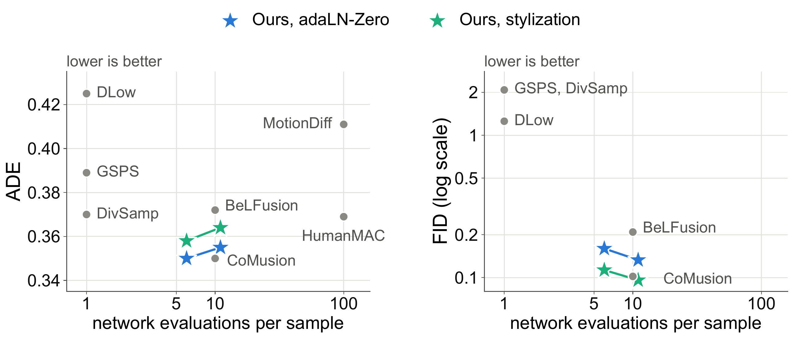

# Fast Diffusion Sampling for Stochastic Human Motion Prediction

Given a short history of 3D poses, predict a *set* of plausible future motions in a handful of network evaluations.

<p align="center">
  
</p>

This repository contains the code of an Honours thesis at the Australian National University. It combines a
Diffusion Transformer denoiser for human motion with fast ODE solvers (DPM-Solver and DPM-Solver++) and
masked completion of the observed frames, so that a full set of diverse, accurate predictions is drawn in as few as
**6 network evaluations per sample**. The thesis is available on request.

---

## Problem

Human motion is not deterministic. A person rising from a chair may walk to the door, turn towards a table or reach
for an object, and each continuation is consistent with what was observed. A useful predictor therefore models a
*distribution* over futures and samples from it (stochastic human motion prediction).

Diffusion models are now the strongest generative models for this task, but they are slow: each sample normally
needs one network evaluation per reverse diffusion step, often 100 or more, and a forecast consists of many samples.
For interactive or safety-critical applications (autonomous driving, human-robot handover, AR/VR) that latency
decides whether the method can be deployed at all.

## Approach

**Representation.** The observed history and the future are treated as one sequence and moved to the frequency
domain with the discrete cosine transform (DCT), keeping only the low-frequency coefficients. Prediction becomes
completion of a masked DCT sequence, following HumanMAC (Chen et al., 2023).

**Denoiser.** A Diffusion Transformer (Peebles & Xie, 2023) operating on DCT coefficients, with two interchangeable
conditioning blocks (adaLN-Zero, or the stylization block of MotionDiffuse), Squeeze-and-Excitation modules that
recalibrate individual frequency bands, and a graph convolutional refinement stage that encodes the skeleton.
The model is trained in a single stage with a single best-of-K noise-prediction loss.

**Sampler.** Sampling is cast as solving the probability flow ODE with DPM-Solver (Lu et al., 2022) or the
data-prediction variant DPM-Solver++ (Lu et al., 2025, called *Guided DPM-Solver* in this work). After every
solver step, the observed frames are re-injected at the current noise level (masking, in the spirit of
RePaint, Lugmayr et al., 2022), so every sample stays consistent with the history. Steps are spaced uniformly in
log-SNR.

<p align="center">
  
</p>

## Results

Human3.6M, standard protocol (25 observed frames, 100 predicted frames, 50 samples per observation).
NFE counts network evaluations per sample; for this work NFE† counts solver evaluations, and one final denoising
evaluation brings the cost of a sample to NFE† + 1 (for example, 6 at NFE† = 5).

| Method | Stages | NFE | APD | ADE ↓ | FDE ↓ | MMADE ↓ | MMFDE ↓ | CMD ↓ | FID ↓ |
|---|---|---|---|---|---|---|---|---|---|
| HumanMAC | 1 | 100 | 6.301 | 0.369 | 0.480 | 0.509 | 0.545 | – | – |
| BeLFusion | ≥2 | 10 | 7.602 | 0.372 | 0.474 | **0.473** | 0.507 | 5.988 | 0.209 |
| CoMusion | 1 | 10 | 7.632 | **0.350** | 0.458 | 0.494 | **0.506** | 3.202 | 0.102 |
| Ours, adaLN-Zero, Guided DPM-Solver-2 | 1 | 5† | 5.765 | **0.350** | 0.464 | 0.492 | 0.526 | 2.895 | 0.160 |
| Ours, stylization, Guided DPM-Solver-2 | 1 | 5† | 6.763 | 0.358 | 0.457 | 0.485 | 0.508 | 4.033 | 0.113 |
| Ours, stylization, DPM-Solver-1 | 1 | 10† | 7.103 | 0.359 | **0.456** | 0.487 | 0.510 | 3.125 | 0.102 |
| Ours, adaLN-Zero, DPM-Solver-2 | 1 | 20† | 7.148 | 0.368 | 0.477 | 0.504 | 0.537 | **1.693** | **0.092** |

Baseline numbers are as reported in the thesis comparison. The full tables (all solvers and budgets, HumanEva-I
and AMASS, per-action results) are in the thesis.

**Findings**

- **Accuracy saturates within a few steps.** Guided DPM-Solver-2 matches the best ADE among the baselines with
  6 network evaluations per sample, against 10 for CoMusion and 100 for HumanMAC, and with a single training stage.
- **Realism keeps improving with more steps.** Going from 5 to 10 or 20 solver evaluations changes ADE and FDE only
  marginally, but lowers FID and CMD; the lowest FID and CMD overall come at NFE† = 20.
- **Data prediction is more stable at very small budgets.** The noise-prediction DPM-Solver-2 diverges at NFE† = 5,
  while the data-prediction (Guided) variant is already the most accurate solver there.
- **The two backbones trade accuracy against diversity.** adaLN-Zero gives lower ADE; the stylization block gives
  higher APD and lower FDE, MMADE and MMFDE.

Reported results sample from the raw (non-EMA) weights saved under `model` in the checkpoint, which gave slightly
better accuracy than the EMA weights (`ema_model`) in a check on Human3.6M.
Evaluation is not seeded, so re-running it, especially on different hardware or operating systems, can change
the metrics slightly.

---

## Getting started

### Install

```bash
git clone https://github.com/Quancoder260503/Human-Pose-Forecasting.git
cd Human-Pose-Forecasting
pip install -r requirements.txt
```

Install the PyTorch build that matches your CUDA version from [pytorch.org](https://pytorch.org) first if the
default wheel does not fit your machine.

### Data

Human3.6M, HumanEva-I and AMASS are used under their own licences and are not redistributed here. The loaders
expect the pre-processed files below; the multi-modal ground truth is only needed for evaluation.

```
dataset/multimodal_set/
  data_3d_h36m.npz
  data_3d_humaneva15.npz
  data_3d_amass.npz, data_3d_amass_test.npz
  data_multi_modal/
    t_his25_1_thre0.500_t_pred100_thre0.100_filtered_dlow.npz
    data_candi_t_his25_t_pred100_skiprate20.npz
```

FID on Human3.6M also needs the action classifier `h36m_classifier.pth` in the repository root. It is not
included in the repository.

### Train

`--model_prefix` is a run name: outputs go to `exp/<run_name>/`. The command below uses the configuration of
the adaLN-Zero model on Human3.6M; use `--use_adaptive False` for the stylization block.

```bash
python3 Main.py --type diffusion --algo diffusion --mode train --dataset h36m --model_prefix <run_name> \
  --use_adaptive True --num_layers 8 --model_dim 512 --ffn_dim 1024 --num_heads 8 --dropout 0.3 \
  --num_gcn_stages 3 --gcn_dim 256 --num_samples 8 --max_epochs 2000 \
  --learning_rate 3e-4 --learning_rate_fn step --lr_step_size 100 --step_gamma 0.9
```

The full configuration of a run is saved to `exp/<run_name>/config_dir/config.json`.

### Evaluate with DPM-Solver

```bash
python3 Main.py --type diffusion --algo diffusion --mode eval_per_action --model_prefix <run_name> \
  --finetuning_ckpt exp/<run_name>/models/model_ckpt.pth.tar --exp_desc dpmsolverpp_2_singlestep_5 \
  --use_dpm_solver True --dpm_algorithm_type dpmsolver++ \
  --dpm_solver_order 2 --dpm_solver_method singlestep --dpm_solver_num_steps 5 \
  --enable_complete True --cfg_scale 1.0
```

In evaluation and visualisation modes, every setting is reloaded from the saved `config.json` except the
sampling flags below, which are taken from the command line. The step spacing is therefore the one saved at
training time (`logSNR` by default).

| Flag | Meaning |
|---|---|
| `--dpm_algorithm_type` | `dpmsolver` (noise prediction) or `dpmsolver++` (data prediction, Guided DPM-Solver) |
| `--dpm_solver_order` | 1, 2 or 3 |
| `--dpm_solver_method` | `singlestep`, `singlestep_fixed`, `multistep` or `adaptive` |
| `--dpm_solver_num_steps` | solver evaluations NFE† |
| `--dpm_solver_type` | `dpmsolver` or `taylor` form of the higher-order update |
| `--enable_complete` | re-inject the observed frames after every step (masking) |
| `--cfg_scale` | classifier-free guidance scale; 1.0 disables guidance |

Results are written as CSV files to `exp/<run_name>/result_dir`.

### Visualise

```bash
python3 Main.py --type diffusion --algo diffusion --mode demo_vis --sampling_mode pred --model_prefix <run_name> \
  --finetuning_ckpt exp/<run_name>/models/model_ckpt.pth.tar --exp_desc demo \
  --use_dpm_solver True --dpm_solver_order 2 --dpm_solver_method singlestep --dpm_solver_num_steps 5 \
  --enable_complete True
```

One GIF per action is written to `exp/<run_name>/gif_dir/demo/`.

---

## Using the sampler with your own model

The masked solver in `model/DPMSolver.py` does not depend on the architecture in this repository. Any pre-trained
diffusion model for motion (or any sequence data) can be sampled with it if the following holds.

**Requirements**

1. **A discrete-time diffusion model** trained with the usual forward process
   x_t = √ᾱ_t · x₀ + √(1 − ᾱ_t) · ε. Only its `betas` (or `alphas_cumprod`) are needed.
2. **A noise-prediction network** callable as `model(x, t, cond)`. With guidance (`guidance_scale != 1`) it must
   also accept `model(x, t)` for the unconditional prediction. A network that predicts x₀ or v needs a small
   wrapper that converts its output to ε.
3. **Time on a 0 to 999 scale.** `get_model_input_time` multiplies by a hard-coded `1000`; a model trained with a
   different number of steps T needs that factor changed to T.
4. **For masking only:**
   - samples are DCT coefficients of the whole sequence, shape `[B, C, D]` (`C` kept coefficients, `D` pose
     dimension). For a model that works directly on poses, pass identity matrices as `dct` and `idct`;
   - `cond` is the DCT of the observation padded to the full length (this repository repeats the last observed
     frame), with the same shape as a sample;
   - `masks` is 1 on observed frames and 0 on future frames, shape `[B, N + F, D]`;
   - `gaussian_process` is any object with `q_sample(x_start, timesteps, gaussian_noise)` using the same noise
     schedule.

**Minimal example**

```python
import torch
from model.DPMSolver import NoiseScheduleVP, DPMSolver
from runner.RunnerUtils import get_dct_matrix

device = 'cuda'
schedule = NoiseScheduleVP(schedule = 'discrete', betas = betas, device = device)  # the model's training betas
dct, idct = get_dct_matrix(N + F)                                                   # N observed, F future frames
dct, idct = dct.float().to(device), idct.float().to(device)

solver = DPMSolver(
  noise_schedule = schedule,
  guidance_scale = 1.0,                 # > 1 enables classifier-free guidance (two passes per step)
  gaussian_process = diffusion,         # anything with q_sample(x_start, timesteps, gaussian_noise)
  model = model,
  num_dct_channels = C,
  dct = dct,
  idct = idct,
  enable_complete = True,               # masking of the observed frames
  algorithm_type = 'dpmsolver++',       # data prediction (Guided DPM-Solver)
)

obs_dct = dct[:C] @ observation_padded  # [B, C, D]
sample_dct = solver.sample(cond = obs_dct, masks = mask, steps = 5, order = 2,
                           method = 'singlestep', skip_type = 'logSNR', denoise_to_zero = True)
motion = idct[:, :C] @ sample_dct       # [B, N + F, D], back to poses
```

**Things to keep in mind**

- **Cost.** With `denoise_to_zero = True`, a sample costs `steps + 1` network evaluations; guidance doubles the
  cost of every evaluation.
- **`cond` has two roles.** It is both the condition passed to the network and the known signal used for masking.
  A model conditioned on something else (an encoded history, text, an action label) needs a separate argument for
  the known frames in `sample()` and `inpainting_complete()`.
- **Device.** `NoiseScheduleVP` defaults to `device = 'cuda'`; pass `device = 'cpu'` to run on CPU.
- **Small budgets.** At 5 or fewer solver evaluations, prefer `dpmsolver++` with order 2 and `singlestep`; the
  noise-prediction second-order solver can diverge there.

---

## References

- Lu et al. *DPM-Solver: A Fast ODE Solver for Diffusion Probabilistic Model Sampling in Around 10 Steps.*
  NeurIPS 2022. Code: [LuChengTHU/dpm-solver](https://github.com/LuChengTHU/dpm-solver), from which
  `model/DPMSolver.py` is adapted.
- Lu et al. *DPM-Solver++: Fast Solver for Guided Sampling of Diffusion Probabilistic Models.*
  Machine Intelligence Research 22, 730–751, 2025. [arXiv:2211.01095](https://arxiv.org/abs/2211.01095)
- Chen et al. *HumanMAC: Masked Motion Completion for Human Motion Prediction.* ICCV 2023.
- Barquero, Escalera, Palmero. *BeLFusion: Latent Diffusion for Behavior-Driven Human Motion Prediction.*
  ICCV 2023.
- Sun, Chowdhary. *CoMusion: Towards Consistent Stochastic Human Motion Prediction via Motion Diffusion.*
  ECCV 2024.
- Peebles, Xie. *Scalable Diffusion Models with Transformers.* ICCV 2023.
- Zhang et al. *MotionDiffuse: Text-Driven Human Motion Generation with Diffusion Model.* IEEE TPAMI 2024.
- Lugmayr et al. *RePaint: Inpainting using Denoising Diffusion Probabilistic Models.* CVPR 2022.

## Acknowledgements

This work was supervised by Prof. Stephen Gould at the Australian National University. The solver implementation
is adapted from the official DPM-Solver code, and the evaluation protocol follows HumanMAC and BeLFusion.

## License

Apache License 2.0, see [LICENSE](LICENSE).
